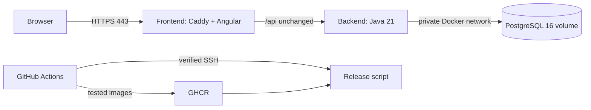

# Deploy SplitEasy on AWS Lightsail Mumbai

This runbook uses **one Linux/Ubuntu 24.04 amd64 instance in Mumbai (`ap-south-1`)**, Docker Compose, PostgreSQL 16, and Caddy HTTPS. Start with the **4 GB / $24 monthly Linux IPv4 bundle** for headroom; 2 GB / $12 can work after measuring memory. Disk, IPv4, and a transfer allowance are bundled; snapshots, backups, domain, taxes, and excess transfer are extra. [AWS bundles](https://docs.aws.amazon.com/lightsail/latest/userguide/amazon-lightsail-bundles.html).



Only the frontend publishes ports. Neither 8080 nor 5432 is reachable from the host/public network. `/actuator/*` is blocked by Caddy; Docker probes backend `/actuator/health/readiness`, which includes a database check. `/api/health` remains simple liveness. Angular deep links fall back to `index.html`; API errors are never rewritten to HTML.

The configuration is implemented in the repository. **Purchasing the instance, setting DNS/secrets, and activating the GitHub workflow are still manual steps.** The scripts perform brief in-place restarts; this is not a zero-downtime or high-availability setup.

## 1. Create the server and address

1. In Lightsail, select **Mumbai**, Linux/Unix, **OS-only Ubuntu 24.04**, and the IPv4 bundle. Name it `spliteasy`. Use the amd64 instance supported by the workflow's `linux/amd64` images.
2. Create and attach a **static IPv4 address** so stop/start does not change DNS. [Static IP instructions](https://docs.aws.amazon.com/lightsail/latest/userguide/lightsail-create-static-ip.html).
3. Point the domain's `app` A record at that address, e.g. `app.example.com`. Avoid an AAAA record unless IPv6 routing/firewalls are also configured correctly. Use DNS-only mode initially if using Cloudflare DNS.
4. Lightsail networking firewall: allow TCP **80 and 443** publicly. Keep **5432, 8080, and 8081 closed**. SSH TCP **22** needs access from your workstation and the deployment runner. Standard hosted Actions runner IPs vary: either permit port 22 with SSH-key-only authentication and rate limiting, or use a runner/network option with stable egress and restrict its range. Do not install an untrusted-PR runner on the production VM. [Lightsail firewall](https://docs.aws.amazon.com/lightsail/latest/userguide/understanding-firewall-and-port-mappings-in-amazon-lightsail.html).
5. Connect initially as `ubuntu` using the Lightsail key. Apply OS updates and install `curl`, `python3`, and `util-linux` (`flock`).

```bash
sudo apt-get update
sudo apt-get upgrade -y
sudo apt-get install -y ca-certificates curl python3 util-linux
```

## 2. Install Docker and create the deployment user

Follow [Docker's Ubuntu installation instructions](https://docs.docker.com/engine/install/ubuntu/). For Ubuntu 24.04 amd64:

```bash
sudo install -m 0755 -d /etc/apt/keyrings
sudo curl -fsSL https://download.docker.com/linux/ubuntu/gpg -o /etc/apt/keyrings/docker.asc
sudo chmod a+r /etc/apt/keyrings/docker.asc
sudo tee /etc/apt/sources.list.d/docker.sources > /dev/null <<'EOF'
Types: deb
URIs: https://download.docker.com/linux/ubuntu
Suites: noble
Components: stable
Architectures: amd64
Signed-By: /etc/apt/keyrings/docker.asc
EOF
sudo apt-get update
sudo apt-get install -y docker-ce docker-ce-cli containerd.io docker-buildx-plugin docker-compose-plugin
sudo systemctl enable --now docker
docker compose version
sudo adduser --disabled-password --gecos '' deploy
sudo usermod -aG docker deploy
sudo install -d -m 0700 -o deploy -g deploy /home/deploy/.ssh
sudo install -d -m 0700 -o deploy -g deploy /opt/spliteasy
sudo install -d -m 0700 -o deploy -g deploy /opt/spliteasy/releases /opt/spliteasy/backups
```

Use current Compose v2 or newer with `up --wait`; the local implementation was validated with Compose v5. The Docker group has root-equivalent host access. This deploy account/key must only be available to trusted production jobs.

Generate a **separate CI SSH key on your workstation**:

```bash
ssh-keygen -t ed25519 -f ~/.ssh/spliteasy-actions -C spliteasy-actions -N ''
```

Install its `.pub` contents into `/home/deploy/.ssh/authorized_keys` using the initial trusted server session. Prefix the public key with `restrict ` to disable forwarding and PTY access while permitting the workflow's noninteractive commands; set file ownership `deploy:deploy` and mode `600`. Keep the private key out of Git.

Test a second SSH session as `deploy` before changing authentication settings. Configure `/etc/ssh/sshd_config.d/60-spliteasy.conf` with `PasswordAuthentication no`, `KbdInteractiveAuthentication no`, and `PermitRootLogin no`; validate with `sudo sshd -t` and reload SSH. Preserve the initial session until the new session works. Consider SSH rate limiting/Fail2ban when port 22 is reachable publicly. The Lightsail firewall controls Docker-published ports; host firewall assumptions alone are insufficient.

### Verify the host key

In the trusted server console/session, obtain the Ed25519 fingerprint:

```bash
sudo ssh-keygen -lf /etc/ssh/ssh_host_ed25519_key.pub
```

On your workstation, replace `STATIC_IP` below with the actual address:

```bash
ssh-keyscan -t ed25519 STATIC_IP > /tmp/spliteasy-known-hosts
ssh-keygen -lf /tmp/spliteasy-known-hosts
```

Compare the fingerprints through that trusted session. Only then use the verified file contents for the GitHub secret. `ssh-keyscan` alone does not authenticate the server. The workflow requires strict host verification; it never accepts arbitrary keys.

## 3. Set production secrets and private-registry access

As `deploy`, create `/opt/spliteasy/.env`. Replace the domain in these commands before running them:

```bash
umask 077
printf 'SITE_ADDRESS=app.example.com\nPUBLIC_ORIGIN=https://app.example.com\nPOSTGRES_PASSWORD=%s\nAPP_JWT_SECRET=%s\n' \
  "$(openssl rand -hex 24)" "$(openssl rand -hex 32)" > /opt/spliteasy/.env
chmod 600 /opt/spliteasy/.env
```

`deploy/.env.example` documents the variables, with intentionally empty passwords. Never use its domain literally or reuse the dev JWT key. The Docker image and Compose stack explicitly select `prod`; a missing JWT variable or a key shorter than 32 bytes fails startup. PostgreSQL credentials and the JWT key remain server-side, outside the transferred release archive and GitHub Actions logs.

`POSTGRES_PASSWORD` initializes a new database volume. **Changing the file does not change the password in an existing PostgreSQL volume.** Rotate the database role's password and configuration together; never delete the volume to rotate credentials. Rotating the JWT key invalidates existing sessions. Root/Docker administrators can inspect container environment variables; file permissions protect against ordinary users, not host administrators.

The workflow publishes private-by-default images to GHCR using its short-lived `GITHUB_TOKEN`. For private pulls, sign in once **as deploy** with a GitHub classic PAT scoped to `read:packages`, and access to this repo's packages (authorize organization SSO if applicable):

```bash
docker login ghcr.io --username YOUR_GITHUB_USERNAME
```

Paste the token at the password prompt. Do not put it in command arguments or commit Docker's credential file. Public packages can be pulled anonymously, but do not make a private project's images public unintentionally. [GHCR authentication](https://docs.github.com/en/packages/working-with-a-github-packages-registry/working-with-the-container-registry).

## 4. Configure GitHub Actions

Create a GitHub environment named **`production`**, restrict it to `main`, and optionally require a human reviewer. Set:

| Location | Name | Value |
|---|---|---|
| Repository variable | `DEPLOY_ENABLED` | `true` after server, DNS, credentials, and environment are ready; absent/false publishes tested images without deploying |
| Production environment variable | `LIGHTSAIL_HOST` | Static IPv4 or hostname matching the verified known-hosts entry |
| Production environment variable | `LIGHTSAIL_USER` | `deploy` |
| Production environment secret | `LIGHTSAIL_SSH_KEY` | Entire private CI SSH key |
| Production environment secret | `LIGHTSAIL_KNOWN_HOSTS` | Verified known-hosts line(s) |

No AWS access key is required by this SSH delivery workflow. Set branch protection to require **Backend tests**, **Frontend tests and build**, and **Verify containers and publish release**. Enable Actions and permit the workflow's package-write permission. For existing GHCR packages, ensure this repository has Actions access to them.

`.github/workflows/ci-cd.yml` does the following:

1. Every PR and every `dev` push: backend tests with throwaway PostgreSQL, frontend tests/build with Node 22, release-script checks, Docker builds, and real container smoke/persistence checks. PRs and `dev` pushes never access production secrets or publish images.
2. A `main` push or manual dispatch **on main**: publish exactly the images that passed the checks to `ghcr.io/<owner>/spliteasy-backend:<commit>` and `...-frontend:<commit>`; owner/repository names are lowercased automatically.
3. Deployment reads the registry digests, verifies SSH, and transfers a release into `/opt/spliteasy/releases/<commit>-<run-id>-<attempt>`. Every run gets a fresh directory, so reruns cannot overwrite the active release manifest. No Git checkout, npm/Maven build, or registry-write credential is needed on the VPS.
4. GitHub serializes production deploy jobs; the server additionally uses `flock`. Superseded main revisions are skipped before SSH deployment. A new commit during an in-flight deployment can briefly leave the prior revision active until its successor finishes.
5. Validate configuration, pull both application images, wait for PostgreSQL, create and inspect a database dump **before Flyway migrations**, replace the applications, wait for readiness, and check the public health endpoint plus Angular login page.
6. Only after checks succeed, atomically promote `current` and preserve `previous`. On failure, the workflow fails and leaves the successful release pointer intact. Actual running containers may already be partly replaced; operators must inspect them before recovery. It deliberately does not automatically roll back the schema or restore user data.

Third-party actions are pinned to verified release commit hashes; Dependabot checks Docker and Actions updates monthly. Base images track Java 21, Node 22, Caddy 2, and PostgreSQL 16; review updates and rebuild regularly. Do not delete GHCR digests required by `current`, `previous`, or a planned rollback.

## 5. First deployment and verification

Use `dev` for development and push there to run CI. Promote tested changes through a `dev` → `main` PR. Only a push/merge into `main` (or manual dispatch on `main`) publishes production images and can deploy. Keep `main` protected with the required checks. The deployment workflow must first be merged into `main`; creating `dev` alone does not install it on either branch. Then bring `dev` up to date from `main` to receive the workflow.

Commit/push the changes when ready and merge into `main`, or run **CI and Lightsail deployment** manually on `main`. The first backup contains an empty pre-migration database; PostgreSQL and TLS volumes are then created and retained. Ensure A-record propagation and public ports 80/443 before this run: Caddy obtains a certificate automatically. [Caddy HTTPS](https://caddyserver.com/docs/automatic-https).

```bash
curl --fail https://app.example.com/api/health
curl --fail -I https://app.example.com/login
```

Register a demo account, log in, create a group/expense, and refresh a group deep link. Verify that the dashboard reflects the change. Re-login is required after the one-hour access token expires. Keep automated authenticated production checks on a dedicated demo account, rather than running `deploy/smoke.py` against production: that script creates test records and is intended only for disposable test stacks.

As deploy, inspect status without printing the full secrets-bearing Compose configuration:

```bash
cd /opt/spliteasy/current
docker compose -p spliteasy --env-file /opt/spliteasy/.env --env-file release.env -f compose.prod.yml ps
docker compose -p spliteasy --env-file /opt/spliteasy/.env --env-file release.env -f compose.prod.yml logs --tail 100 backend frontend
```

Keep `BACKEND_IMAGE`, `FRONTEND_IMAGE`, and configuration variables unset in your shell when using manual Compose commands; exported variables override env files. Release/backup scripts clear these exports to enforce their manifests. Avoid `docker compose config` without `--quiet`, which prints resolved secrets.

## 6. Backups and restore drills

Pre-release backups are not a daily schedule. Add a deploy-user cron job for daily backups; `/opt/spliteasy/current` follows the successful release:

```cron
# 20:00 UTC = 01:30 IST; server/cron timezone must be UTC.
0 20 * * * /bin/bash /opt/spliteasy/current/deploy/backup.sh >> /opt/spliteasy/backup.log 2>&1
```

`backup.sh` takes a transaction-consistent custom-format `pg_dump`, verifies that `pg_restore` can read its directory, and saves it with restrictive permissions. This is an archive sanity check, **not a complete restore test**. It uses the same host lock as deployment.

Backups on the same instance do not protect against losing that instance/disk. Choose either encrypted downloads to another machine, or a **private S3 bucket in Mumbai** with public access blocked, encryption enabled, and a lifecycle retention policy. To use the script's S3 upload option, install AWS CLI v2 from [AWS instructions](https://docs.aws.amazon.com/cli/latest/userguide/getting-started-install.html), configure a dedicated credential with `s3:PutObject` only for the backup prefix, and set `BACKUP_S3_URI=s3://YOUR_BUCKET/spliteasy` in the cron command. Lightsail does not supply this workflow with an EC2 instance-profile role; configure authentication explicitly. Never reuse broad administrator credentials.

```cron
0 20 * * * BACKUP_S3_URI=s3://YOUR_BUCKET/spliteasy /bin/bash /opt/spliteasy/current/deploy/backup.sh >> /opt/spliteasy/backup.log 2>&1
```

S3 uploads request server-side AES256 encryption; HTTPS protects transfer. Retain e.g. 7 daily and 4 weekly copies according to your needs. Remove local old backups only after confirming off-server copies and a successful restore drill. The script does not automatically delete archives. Rotate `backup.log`, monitor failures, and check disk space. Provider snapshots are an additional safeguard, not a substitute for PostgreSQL backups.

Test restoration into a **separate disposable PostgreSQL database/container**. Transfer one dump to a test machine, start a separate Postgres 16 container with a new volume, then:

```bash
# 'spliteasy-restore-test' is an independently created disposable container, not production.
docker exec -i spliteasy-restore-test pg_restore -U spliteasy -d spliteasy --no-owner --no-acl --exit-on-error < backup.dump
```

Inspect Flyway history, user/group counts, and representative balances; run the matching backend image against the restored DB. Successful archive listing alone does not prove these checks.

For an actual production restore: stop application writes, take a fresh rescue dump, verify the selected archive, and restore into a new database/volume first. Point the matching application revision at it and validate before reopening writes. A restore discards changes newer than the selected backup unless separately reconciled; perform it deliberately. **Never use `down --volumes` on production.**

## 7. Failed release and manual rollback

Check the failing job, container status/logs, disk/memory, DNS/certificate status, GHCR permissions, and Flyway history. `current` identifies the last successful release, but containers may be running the failed candidate. `previous` identifies the successful release before `current`.

**First decide whether the live schema is compatible with the target application.** Flyway does not undo migrations when switching image digests. For additive compatible migrations, redeploy the target's immutable release; for incompatible migrations, prefer a forward fix. Do not auto-restore a backup over newer records.

```bash
# To recover from a failed candidate to the last successful version:
bash /opt/spliteasy/current/deploy/deploy.sh

# To roll back a successfully promoted release, only after schema compatibility review:
bash /opt/spliteasy/previous/deploy/deploy.sh
```

Both paths take a fresh backup, pull the recorded digest pair, check readiness/HTTPS, and update pointers only on success. Deploying `previous` swaps the success history; this is expected. Preserve the candidate release directory and logs for diagnosis. Manual rollback uses the same server lock, but disable `DEPLOY_ENABLED` during incident recovery so a queued workflow cannot immediately replace it. Re-enable when the intended main revision is ready.

## 8. Local verification without Lightsail

Use an isolated project so the existing development PostgreSQL volume is unaffected:

```bash
# Create a private temporary env file from deploy/.env.example; use fresh test secrets.
# Set SITE_ADDRESS=:80, PUBLIC_ORIGIN=http://localhost:18080,
# HTTP_PORT=127.0.0.1:18080 and HTTPS_PORT=127.0.0.1:18443 (loopback only).
docker compose -p spliteasy-check --env-file /tmp/spliteasy-test.env -f compose.prod.yml up -d --build --wait --wait-timeout 180
python3 deploy/smoke.py
docker compose -p spliteasy-check --env-file /tmp/spliteasy-test.env -f compose.prod.yml down
docker compose -p spliteasy-check --env-file /tmp/spliteasy-test.env -f compose.prod.yml up -d --no-build --wait --wait-timeout 180
python3 deploy/smoke.py verify-persistence
# Remove only the disposable test stack's volumes after validation:
docker compose -p spliteasy-check --env-file /tmp/spliteasy-test.env -f compose.prod.yml down --volumes
python3 -m unittest discover -s deploy/tests -v
```

Backend/runtime users are non-root; filesystem writes are limited to temporary paths and Caddy's certificate/config volumes. Container memory ceilings total about 1.6 GiB; measure with `docker stats`, leave host headroom, and adjust limits if necessary. Build work happens on CI. Image pruning may free disk, but retain rollback images and never prune database volumes. Review OS/PostgreSQL patch updates with a fresh backup and a maintenance window.

## Application limitations before inviting real users

This change supplies deployment infrastructure and isolates production JWT configuration. It does not implement refresh tokens or fix unrelated findings identified in the earlier architect review: split overflow, cross-account cached dashboard state, and aggregate snapshot consistency still need attention. The project memory requires refresh tokens before real deployment; treat the current one-hour-session app as a personal demo until that work is done. Deployment scripts are ready to configure, but hosting readiness is not a claim that these application defects have been resolved.
