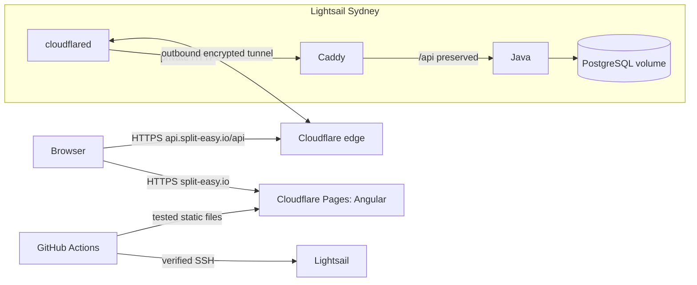

# Deploy SplitEasy: Cloudflare Pages + Lightsail + Tunnel + Caddy

This is the current deployment guide. It replaces the earlier instructions that hosted Angular on Lightsail and opened ports 80/443. Follow the numbered sections in order. Commands say **where to run them**; do not run server commands on your Mac.

## What each service does

| Service | Its job |
| --- | --- |
| Cloudflare Pages | Stores Angular's built HTML/JavaScript/CSS and serves `https://split-easy.io`. |
| Lightsail | Your rented Ubuntu computer in AWS Sydney. It runs Docker continuously. |
| Java backend | Handles login, groups, expenses and balances. |
| PostgreSQL | Stores application data in a persistent Docker volume. |
| Caddy | Routes `/api` to Java and rejects other paths, including `/actuator`. |
| cloudflared / Cloudflare Tunnel | Creates an outbound encrypted connection from Lightsail to Cloudflare. It exposes the API without public application ports. |
| GitHub Actions | Tests changes, builds the Java image, then deploys Java and Angular after promotion to `main`. |
| GHCR | GitHub Container Registry, which stores the tested Java Docker image. |



Users visit **split-easy.io** directly. Angular automatically calls **api.split-easy.io**. There is no `app` hostname or redirect. HTTPS is provided by Cloudflare; Caddy uses HTTP inside the host's private Docker networks. Caddy does not need a public certificate or exposed port 443 in this architecture.

This is one server with brief restarts during deployment. PostgreSQL and the backend do not scale independently. Regular backups are part of operating it.

## 1. Before starting

Have access to your AWS account, Cloudflare account holding `split-easy.io`, and GitHub repository `dHRvBiyAn1/SplitEasy`. Keep secrets in the provider settings or server files, never in Git or chat.

The repository changes must be committed/pushed and promoted from `dev` to `main` before GitHub can run the new workflow. Local edits alone cannot deploy. The workflow is **CI and Pages + Lightsail deployment**. Keep repository variable `DEPLOY_ENABLED` absent or `false` throughout setup.

Current AWS bundle choices are 2 GB RAM / $12 monthly or 4 GB / $24 monthly, before tax, backups and excess transfer. Start with 2 GB for this small project if budget is the priority; 4 GB gives headroom. Choose a Linux instance **with public IPv4**, not an IPv6-only bundle, because the current GitHub SSH delivery uses IPv4. Pages static hosting is free within its plan limits. [AWS pricing](https://aws.amazon.com/lightsail/pricing/), [Pages pricing](https://developers.cloudflare.com/pages/functions/pricing/).

## 2. Lightsail in Sydney — AWS website

The user chose to keep the existing Sydney instance. If it is already created and configured, reuse it; do not create another instance. The steps below describe provisioning from scratch.

1. Open [Lightsail](https://lightsail.aws.amazon.com/) and choose **Create instance**.
2. Select **Asia Pacific (Sydney)** (`ap-southeast-2`).
3. Select **Linux/Unix → OS Only → Ubuntu 24.04 LTS**. Use the amd64/x86 instance compatible with our `linux/amd64` image. Avoid a preinstalled WordPress/Plesk blueprint.
4. Choose your IPv4 bundle and name the instance `spliteasy`. Creating it starts billing.
5. Wait until its status is **Running**, then open the instance's **Networking** tab.
6. Create and attach a **static IPv4 address** in Sydney. Name it `spliteasy-static-ip`. Save this address: GitHub uses it for SSH. Do not point the application DNS at it.
7. Leave TCP **22** for SSH. Remove public HTTP/HTTPS rules on **80 and 443**. Also keep **5432, 8080 and 8081** closed, including IPv6 rules.

GitHub-hosted runners have changing IPs. This guide retains key-only SSH on 22 reachable by the runner. If you restrict 22 only to your own IP, GitHub deployment will fail; stable-egress runner/network setup is an alternative. Do not put an untrusted-PR runner on the production server. Cloudflare Tunnel protects the application path; it does not replace the separate SSH path in this workflow.

Open **Connect using SSH** in the Lightsail browser console. You are now on the server as `ubuntu`. [Static IP guide](https://docs.aws.amazon.com/lightsail/latest/userguide/lightsail-create-static-ip.html).

## 3. Install Docker — Lightsail browser terminal

Docker runs isolated application processes; Compose starts them with the correct networks, configuration and storage.

```bash
sudo apt-get update
sudo apt-get upgrade -y
sudo apt-get install -y ca-certificates curl python3 util-linux
```

Install Docker using its official Ubuntu repository:

```bash
sudo install -m 0755 -d /etc/apt/keyrings
sudo curl -fsSL https://download.docker.com/linux/ubuntu/gpg -o /etc/apt/keyrings/docker.asc
sudo chmod a+r /etc/apt/keyrings/docker.asc
sudo tee /etc/apt/sources.list.d/docker.sources > /dev/null <<'EOF'
Types: deb
URIs: https://download.docker.com/linux/ubuntu
Suites: noble
Components: stable
Architectures: amd64
Signed-By: /etc/apt/keyrings/docker.asc
EOF
sudo apt-get update
sudo apt-get install -y docker-ce docker-ce-cli containerd.io docker-buildx-plugin docker-compose-plugin
sudo systemctl enable --now docker
docker compose version
sudo adduser --disabled-password --gecos '' deploy
sudo usermod -aG docker deploy
sudo install -d -m 0700 -o deploy -g deploy /home/deploy/.ssh
sudo install -d -m 0700 -o deploy -g deploy /opt/spliteasy
sudo install -d -m 0700 -o deploy -g deploy /opt/spliteasy/releases /opt/spliteasy/backups
```


The `deploy` user is dedicated to trusted deployments. Membership in the Docker group grants powerful host access, so protect its SSH key. Leave this browser terminal open during key setup. [Docker installation](https://docs.docker.com/engine/install/ubuntu/).

## 4. Create the GitHub deployment key — your Mac

Open Terminal on your Mac. Generate a new key dedicated to this app:

```bash
ssh-keygen -t ed25519 -f ~/.ssh/spliteasy-actions -C spliteasy-actions -N ''
cat ~/.ssh/spliteasy-actions.pub
```

If that filename already exists, reuse the existing dedicated key or choose another filename; do not overwrite an existing key accidentally. Copy the **public** key line printed by the second command.

Back in the **Lightsail browser terminal**, edit the authorized-key file:

```bash
sudo nano /home/deploy/.ssh/authorized_keys
```

Put one line in the file: `restrict ` followed by the complete public key. In nano, save with Ctrl+O, Enter, then exit with Ctrl+X. `restrict` disables forwarding/PTY but allows the workflow's commands.

```bash
sudo chown deploy:deploy /home/deploy/.ssh/authorized_keys
sudo chmod 600 /home/deploy/.ssh/authorized_keys
sudo ssh-keygen -lf /etc/ssh/ssh_host_ed25519_key.pub
```

Save the server fingerprint from this trusted console. On **your Mac**, substitute your static IP for `STATIC_IP`:

```bash
ssh-keyscan -t ed25519 STATIC_IP > /tmp/spliteasy-known-hosts
ssh-keygen -lf /tmp/spliteasy-known-hosts
```

The two fingerprints must match. `ssh-keyscan` alone does not authenticate the server. Once they match, test a second connection **from a new Terminal window on your Mac**, not from the Lightsail browser terminal or an existing server SSH session:

```bash
ssh -i ~/.ssh/spliteasy-actions -o UserKnownHostsFile=/tmp/spliteasy-known-hosts -o StrictHostKeyChecking=yes deploy@STATIC_IP whoami
```

A successful test prints `deploy` and returns to your Mac prompt. The dedicated CI key uses `restrict`, so this command test avoids requesting an interactive terminal.

If the warning mentions `/home/ubuntu/.ssh/spliteasy-actions`, the command is running on Lightsail and is looking for the Mac's key on the server. Open a fresh local Mac Terminal window and rerun it there. The private-key path should resolve under `/Users/.../.ssh/`. The known-hosts file must also be created on your Mac; `/tmp` files on the Mac and server are separate and can disappear after restarting.

Only proceed once the Mac SSH test above prints `deploy`. Keep the **Lightsail browser terminal as ubuntu** open until the new settings are tested. This gives you working access to correct a problem.

This step makes new SSH logins use keys, disables interactive password prompts and blocks direct login as the powerful `root` user. The `ubuntu` and `deploy` users can still use their authorized keys; `ubuntu` can perform administration with `sudo`.

In the **Lightsail browser terminal as ubuntu**, paste this entire block. The `EOF` line must be alone on its line. It writes the SSH settings file:

```bash
sudo tee /etc/ssh/sshd_config.d/00-spliteasy.conf > /dev/null <<'EOF'
PasswordAuthentication no
KbdInteractiveAuthentication no
PermitRootLogin no
EOF
```

Then validate and apply the settings:

```bash
sudo sshd -t && sudo systemctl reload ssh
```

No output usually means success. If there is an error, keep the browser terminal open and resolve it before continuing; the reload above runs only when validation succeeds.

Open a **fresh Terminal window on your Mac**, and test a new authenticated command (replace STATIC_IP):

```bash
ssh -i ~/.ssh/spliteasy-actions -o UserKnownHostsFile=/tmp/spliteasy-known-hosts -o StrictHostKeyChecking=yes deploy@STATIC_IP whoami
```

If it prints `deploy`, the new settings work. The command then ends normally; you do not need to keep a Mac SSH session open. Continue using the browser terminal for server setup.

Fail2ban/rate limiting is optional additional protection against repeated login attempts. It is not required to complete this step and can be configured separately after the basic deployment works.

## 5. Generate the application secrets — server terminal as deploy

In the **Lightsail browser terminal as ubuntu**, first run `sudo -iu deploy` to become the deployment user. This switches users on the server; it does not open another SSH connection. For later steps that require ubuntu, type `exit` once to return to that original browser session.

The `deploy` account has no password and cannot run administrative `sudo` commands. Run those commands as `ubuntu` in the browser terminal. If a sudo prompt asks for deploy's password, cancel it with Ctrl+C, then return to ubuntu using `exit` or open a fresh browser terminal.

These secrets remain on Lightsail. The frontend must never contain them. The following creates the file only if it does not already exist, avoiding accidental database-password replacement:

```bash
python3 - <<'PYENV'
import os, secrets
from pathlib import Path
os.umask(0o077)
p = Path('/opt/spliteasy/.env')
with p.open('x') as f:
    f.write('PUBLIC_ORIGIN=https://split-easy.io\n')
    f.write('API_ORIGIN=https://api.split-easy.io\n')
    f.write('TUNNEL_TOKEN_FILE=/opt/spliteasy/tunnel.token\n')
    f.write('POSTGRES_PASSWORD=' + secrets.token_hex(32) + '\n')
    f.write('APP_JWT_SECRET=' + secrets.token_hex(48) + '\n')
os.chmod(p, 0o600)
PYENV
```

If the file already exists, edit it carefully rather than running a command that replaces it. Preserve the existing database password and JWT secret; changing a PostgreSQL container environment variable does not change an already initialized database's password.

## 6. Create the API tunnel — Cloudflare website, then server

In Cloudflare select the account holding `split-easy.io`, then **Networking → Tunnels**. Some accounts also show tunnels under **Zero Trust → Networks → Connectors**.

1. Create a **Cloudflared** tunnel named `spliteasy-api`.
2. Select the Docker connector instructions. The dashboard shows a command containing a **tunnel token**. Copy only the token; do not run the sample command, because Compose will manage this container.
3. Add a **Published application route** with subdomain `api`, domain `split-easy.io`, no path restriction, service type **HTTP**, URL **`caddy:80`**. Its full origin is `http://caddy:80`.
4. Save. Cloudflare creates the tunnel's DNS record. Do not add an API A record pointing to Lightsail, and do not set the service to `localhost:80`: inside cloudflared, localhost means cloudflared itself.
5. The tunnel can remain disconnected until the first deployment starts its connector. That is expected.

Store the token on Lightsail. In the **browser server console as ubuntu**, run the file-creation command first:

```bash
sudo install -m 0400 -o 65532 -g 65532 /dev/null /opt/spliteasy/tunnel.token
```

Run **only this next line**, wait for its prompt, paste the actual token copied from Cloudflare, and press Enter. Input is hidden:

```bash
read -r -s -p 'Paste the tunnel token, then press Enter: ' tunnel_value
```

After entering the token, run these lines to save it:

```bash
printf '\n'
printf '%s' "$tunnel_value" | sudo tee /opt/spliteasy/tunnel.token > /dev/null
unset tunnel_value
sudo chown 65532:65532 /opt/spliteasy/tunnel.token
sudo chmod 400 /opt/spliteasy/tunnel.token
sudo stat -c 'Token file: %s bytes; owner %u:%g; mode %a' /opt/spliteasy/tunnel.token
```

The size must be greater than zero, with owner `65532:65532` and mode `400`. The stat command displays metadata, never the token. Creating the file alone does not populate it. For an existing token file, skip the install command, which truncates it; start with the hidden prompt to replace its value deliberately.

UID 65532 is the non-root cloudflared user. The private file is mounted read-only; the release script verifies that this UID can read it without printing it. Do not give all users permission to read the token.

Normal Lightsail outbound networking allows the connection. If you added an outbound firewall, allow Cloudflare's required **TCP/UDP 7844**, plus DNS/HTTPS for registry access. No public application inbound ports are required. [Create tunnel](https://developers.cloudflare.com/cloudflare-one/networks/connectors/cloudflare-tunnel/get-started/create-remote-tunnel/), [firewall requirements](https://developers.cloudflare.com/cloudflare-one/networks/connectors/cloudflare-tunnel/configure-tunnels/tunnel-with-firewall/).

This is a public API protected by our application's JWT login. Do not add a Cloudflare Access interactive login requirement to the API in this setup; that would require a separate browser/API authentication integration. For the API hostname, create a **Cache Rule → Bypass cache** matching `http.host eq "api.split-easy.io"`. Caddy also returns `Cache-Control: no-store` for API routes. Do not apply a Cache Everything rule to private API responses.

## 7. Create Pages and attach split-easy.io — your Mac and Cloudflare

Create a **Direct Upload** project, rather than connecting GitHub's automatic Pages build: GitHub Actions will publish only after our tests pass.

For predictable project/production-branch creation, use Wrangler once on your Mac. Install/use **Node 22** first; `node --version` must report v22. If you use Homebrew:

```bash
brew install node@22
export PATH="$(brew --prefix node@22)/bin:$PATH"
node --version
```

Alternatively install Node 22 from the official Node.js downloads. In **your Mac terminal**, from this repository:

```bash
cd frontend
npm ci
npx wrangler login
npx wrangler pages project create spliteasy --production-branch=main
```

Wrangler opens a browser for you to authorize your Cloudflare account. Select the account that owns the domain. The last command creates the Direct Upload project with `main` as its production branch. If the project already exists, use it and verify its production branch instead of recreating it.

Make a temporary setup page for the initial deployment:

```bash
mkdir -p /tmp/spliteasy-bootstrap
printf '<!doctype html><html><body>SplitEasy setup in progress.</body></html>' > /tmp/spliteasy-bootstrap/index.html
npx wrangler pages deploy /tmp/spliteasy-bootstrap --project-name=spliteasy --branch=main
```

This publishes only a placeholder. The workflow will replace it with the tested Angular artifact. A dashboard drag-and-drop Direct Upload project is also possible, but verify its production branch is `main`; it may require the Pages API to set that field.

Now in the **Cloudflare website**:

1. Open **Workers & Pages → spliteasy → Custom domains → Set up a custom domain**.
2. Enter **`split-easy.io`** (no app prefix).
3. Confirm the DNS association and wait until domain/certificate status is **Active**.
4. Open `https://split-easy.io`: it should show the setup message.

Associate the domain through Pages first; a manually created CNAME without Pages registration is insufficient. Since Cloudflare already manages your domain, it can create the apex DNS record. Keep existing mail/MX/TXT records. [Pages Direct Upload](https://developers.cloudflare.com/pages/get-started/direct-upload/), [custom domains](https://developers.cloudflare.com/pages/configuration/custom-domains/).

## 8. Give Lightsail permission to pull the Java image — GitHub and deploy terminal

GitHub Actions uses its automatic `GITHUB_TOKEN` to publish the backend image. That token is not copied to the server.

If the GHCR package is public, anonymous pulls work. If it is private (a new package can be private), create a separate GitHub personal access token with **read:packages** permission and access to this package. For organizations, authorize SSO if required. On the **server as deploy**:

```bash
read -r -p 'GitHub username: ' registry_user
read -r -s -p 'Paste the read:packages token: ' registry_token
printf '\n'
printf '%s' "$registry_token" | docker login ghcr.io -u "$registry_user" --password-stdin
unset registry_token registry_user
```

Docker stores these credentials under the deploy user's home. Authenticate as deploy, because that user runs the release. Renew credentials before expiration. App DB/JWT secrets and the tunnel token do not belong in GHCR login.

## 9. Configure GitHub — repository website

Open **Settings → Environments → New environment**, name it **production**, and allow deployment from **main**. A required-reviewer rule is optional; enabling it makes each deploy wait for approval.

Within that environment add:

| Type | Name | Value |
| --- | --- | --- |
| Variable | `LIGHTSAIL_HOST` | Your Lightsail static IPv4 address |
| Variable | `LIGHTSAIL_USER` | `deploy` |
| Variable | `CLOUDFLARE_ACCOUNT_ID` | Account ID of the Cloudflare account holding Pages |
| Variable | `CLOUDFLARE_PAGES_PROJECT` | `spliteasy` |
| Secret | `LIGHTSAIL_SSH_KEY` | Complete dedicated private key, including BEGIN/END lines |
| Secret | `LIGHTSAIL_KNOWN_HOSTS` | Contents of the fingerprint-verified known-hosts file |
| Secret | `CLOUDFLARE_API_TOKEN` | Token scoped to this account with **Account → Cloudflare Pages → Edit** |

Create the Cloudflare API token under **My Profile → API Tokens** (or account API tokens), choose a custom token, grant Pages Edit and restrict it to the correct account. Copy it immediately to the GitHub environment secret. Find the Account ID in the Cloudflare account/domain overview; it is different from Zone ID. [Pages CI credentials](https://developers.cloudflare.com/pages/how-to/use-direct-upload-with-continuous-integration/).

On **your Mac**, these commands copy the SSH values to the clipboard without displaying the private key:

```bash
pbcopy < ~/.ssh/spliteasy-actions
# Paste into LIGHTSAIL_SSH_KEY, then copy the next value:
pbcopy < /tmp/spliteasy-known-hosts
```

The token file remains server-only: it is not `CLOUDFLARE_API_TOKEN` and does not go into GitHub. No AWS access-key secret is required for this SSH delivery.

## 10. Activate the first real deployment — GitHub website

Confirm the new workflow is on `main`, Docker/deploy SSH works, the server env/token file exist, the API route is saved, the Pages custom domain is Active, and GHCR access is ready. Then open **Settings → Secrets and variables → Actions → Variables** and create a **repository** variable:

```text
DEPLOY_ENABLED = true
```

It must be repository-scoped because the job checks it before loading environment settings.

Open **Actions → CI and Pages + Lightsail deployment → Run workflow**, choose branch **main**, and run it. It will:

1. Run Java and Angular tests/formatting and build Angular's production files.
2. Build/test the Java container with PostgreSQL/Caddy, then publish its exact digest to GHCR.
3. Download that same run's Angular artifact.
4. SSH to the server, create a unique release directory and transfer its configuration.
5. Validate the tunnel token, pull images, start PostgreSQL, take a verified backup, then start Java/Caddy/cloudflared.
6. Check Java's DB readiness and `https://api.split-easy.io/api/health` through the tunnel.
7. Promote the backend release pointer, upload Angular to Pages, and check frontend deep links.

Watch each job. Missing credentials or a backend/tunnel failure stop Pages upload. If Pages upload fails after the backend succeeds, the backend stays deployed and the job reports failure. The two providers cannot publish atomically. Rerun after fixing the issue; do not restore the database just because Pages failed.

## 11. Verify the live app — browser and your Mac

Open `https://api.split-easy.io/api/health`. Expect JSON with `status: UP`. Open `https://split-easy.io`: expect Angular's login/register screen, not the setup placeholder.

Create your own account, log in, create a group and an expense, refresh, then log out/in and verify the data persists. Browser Developer Tools → Network should show API calls to **api.split-easy.io**, without CORS errors. No one needs to browse the API domain to use the application.

```bash
curl -fsS https://api.split-easy.io/api/health
curl -I https://api.split-easy.io/actuator/health/readiness
```

The second request should be 404; management endpoints are private. `/api/dashboard` without a token should be 401. Direct Lightsail application ports should remain closed. The GitHub public smoke checks never register disposable users in production; disposable accounts are created only in local/CI tests.

## 12. Daily development

Work on `dev`; its pushes run CI without deployment. Create a `dev` → `main` PR, wait for green checks, then merge. A main push runs tests and deploys the new backend and Pages artifact automatically once activation is enabled. Do not make manual Pages uploads part of normal deployment: use the tested workflow.

Local `npm start` still calls relative `/api` through the Angular development proxy. A production build calls `https://api.split-easy.io/api`. Backend CORS allows exactly `https://split-easy.io`; Pages previews and pages.dev are not automatically allowed to use production data.

## 13. Logs, failures and recovery — server as deploy

After a successful release:

```bash
cd /opt/spliteasy/current
docker compose -p spliteasy --env-file /opt/spliteasy/.env --env-file release.env -f compose.prod.yml ps
docker compose -p spliteasy --env-file /opt/spliteasy/.env --env-file release.env -f compose.prod.yml logs --tail=100 backend caddy cloudflared
```

On the first failed release, `current` may not exist. Use the exact release directory shown in GitHub's job instead. After a later failed release, `current` records the last successful release, but containers may already reflect the attempted release: inspect actual image/state before recovering. Avoid posting full server configuration or logs containing credentials publicly.

| Symptom | First checks |
| --- | --- |
| SSH fails | Static IP, port 22, deploy public key, private key and verified host fingerprint |
| Token permission failure | Nonempty token file; UID/GID 65532; mode 0400; absolute configured host path |
| Tunnel disconnected / API 1033 | Connector logs, token, outbound 7844 connectivity |
| API 502 | Tunnel service must be `http://caddy:80`; Caddy/backend health and shared networks |
| API 404 on expected route | Preserve `/api`; tunnel path field empty; check request URL |
| Browser CORS error | Frontend really at split-easy.io; PUBLIC_ORIGIN exact; no Access challenge intercepting API |
| Registry denied | Deploy user's GHCR login, package visibility/access and token expiry |
| Pages error | Correct account ID, Pages Edit token, project name and production branch |
| Old frontend | Pages may briefly serve previous HTML after upload. The workflow retries each public route up to 12 times before failing; check the custom domain/project and artifact revision if it persists. A failed frontend check leaves the backend deployed. |

### Backups

The release script takes a local PostgreSQL dump before every migration, but you also need daily backups stored outside the VM. On the server as deploy:

```bash
bash /opt/spliteasy/current/deploy/backup.sh
crontab -e
```

Example daily cron entry (server UTC, 20:30 UTC = 02:00 IST):

```text
30 20 * * * /bin/bash /opt/spliteasy/current/deploy/backup.sh >> /opt/spliteasy/backup.log 2>&1
```

The script retains local dumps and validates their archive structure. It does not delete old backups automatically; check disk usage and choose retention deliberately. Add a Lightsail snapshot schedule for whole-server recovery if desired; it has separate charges.

For off-host backups, use the script's optional `BACKUP_S3_URI` with an AWS CLI installed for the deploy user, a **private** S3 bucket, and credentials scoped to only that backup prefix. Example cron command once separately configured:

```text
30 20 * * * BACKUP_S3_URI=s3://YOUR_PRIVATE_BUCKET/spliteasy /bin/bash /opt/spliteasy/current/deploy/backup.sh >> /opt/spliteasy/backup.log 2>&1
```

`BACKUP_S3_URI` belongs in the cron environment/command; simply adding it to the Compose .env does not export it to the backup shell. S3 storage/requests are extra. A small private bucket in Sydney is suitable; do not grant public access. Alternatively regularly copy dumps to another secure machine. Check backup.log and test a restore into a separate temporary database before trusting recovery.

For a safe restore drill, replace `BACKUP_FILE` with one existing dump path, use the current Compose command as a shell function, and restore into a **new test database**, never over the live database:

```bash
cd /opt/spliteasy/current
dc() { docker compose -p spliteasy --env-file /opt/spliteasy/.env --env-file release.env -f compose.prod.yml "$@"; }
dc exec -T postgres createdb -U spliteasy restore_drill
dc exec -T postgres pg_restore -U spliteasy -d restore_drill < BACKUP_FILE
dc exec -T postgres psql -U spliteasy -d restore_drill -c 'select count(*) from users;'
# After inspecting the restored data, remove only the disposable drill database:
dc exec -T postgres dropdb -U spliteasy restore_drill
```

### Rollback

For frontend rollback, use Cloudflare Pages' previous **production** deployment → rollback action, or redeploy the intended tested artifact. Confirm it remains compatible with the current API.

For backend rollback, inspect Flyway/schema compatibility first. Only if the previous backend can use the current schema, run the previous release script:

```bash
bash /opt/spliteasy/previous/deploy/deploy.sh
```

This takes another backup and runs health checks. It never restores a previous database. If the migration is incompatible, prefer a forward fix; a database restore is an explicit maintenance operation and can lose newer writes. Never run `docker compose down --volumes` on production or delete the `spliteasy_postgres-data` volume. The runbook's volume-removal commands are only for isolated disposable verification projects.

### Rotate the tunnel token

Rotate it in Cloudflare, securely replace the server token file while preserving UID 65532/mode 0400, then force-recreate cloudflared from the current release. Verify tunnel health and the public API. Do not replace it with the Pages API token.

## Implementation verification

Local verification checks Java/Angular suites, production build, real Caddy validation, no published production ports, API authentication/CORS, persistence after recreation, real dump/restore, release failure guards and workflow/script lint. Live Cloudflare DNS/tunnel/Pages publication requires your accounts and server; local verification does not mean the app is publicly deployed.
