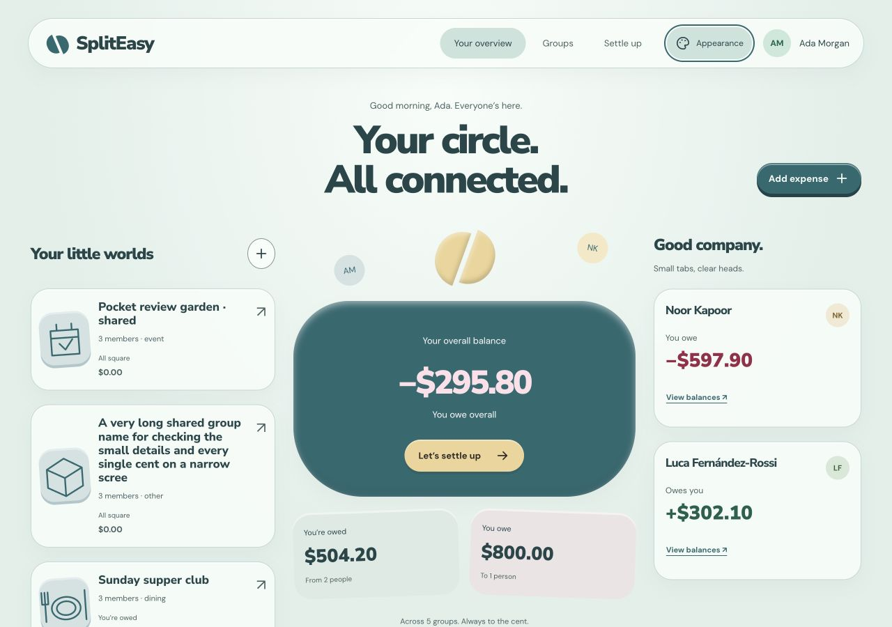

# Pocket Objects — Angular implementation verification

17 October 2026 · `feat/ui-redesign`, implementation based on `597fc93`.

The selected design is implemented across the actual Angular app: shell, overview, group detail,
group settings, login, registration, profile and every global modal. The separate studies on port 4317
remain design references. The working app is on **http://127.0.0.1:4320/dashboard**.

## Delivered behavior

- Seafoam & Petrol is the default palette. Lilac & Plum and Peach & Cocoa are independent of
  System/Light/Dark mode; choices persist on this device. Explicit mode also sets native form controls.
- Local licensed Nunito Sans / DM Sans fonts, rounded group objects and balance scene, SVG artwork,
  and shared financial-status tokens replace the earlier Evenly styling.
- The mobile/tablet dock has Overview, Groups, Expense and Profile icons with labels. One active
  destination follows the route/modal; dismissing Expense restores the previous destination and focus.
- One optional Silk Ribbon canvas and native SVG tip serve mouse input. Passive touch bloom/trace
  preserves native gestures. Session reset, cancellation, multi-touch, blur/hidden state, reduced motion
  and teardown clear the decoration. System accessibility settings take priority.
- Bounded glass sheen and press feedback use shared CSS; unsupported blur, forced colors and reduced
  motion have fallbacks. No new package or animation framework was installed.
- Shared named dialogs trap/restore focus, lock body scrolling and make the background inert. Forms
  retain their APIs and integer-cent split/payment behavior.

## Automated checks

| Check | Result |
|---|---|
| Node 22 frontend Vitest | **105 passed / 22 files**, baseline 80 |
| Java 21 backend suite, disposable Testcontainers PostgreSQL | **138 passed**, no failures/errors/skips |
| Existing deployment Python regressions | **12 passed** |
| Prettier over frontend source | Passed |
| `git diff --check` | Passed |
| Production Angular build | Passed, no warnings or budget changes |

Build: **470.71kB raw initial /114.67kB estimated transfer**, compared with the audited baseline
417.91/105.08kB. Estimated transfer growth is 9.59kB. WOFF2 assets total 112872 bytes, with OFL licenses.
These are build estimates, not measured network loading or field performance.
[Build metrics](build-metrics.json).

The native compiler aborted inside the sandbox; the permitted outside-sandbox build succeeded with
Node 22. No dependency reinstall or runtime version change was used as a workaround. There is no
frontend lint script, so no separate frontend lint result is claimed.

Meaningful regressions were run before implementation. New coverage includes independent palette/mode
persistence and invalid stored values, native color scheme, OS-authoritative reduction, dialog naming
and scroll locking, dock selection, canvas ownership/teardown, retained refresh data and account clear,
failed initial loading, reordered group reads and invalidated expanded receipts.

## Browser evidence

Actual in-app browser, synthetic local accounts/data only. No production writes were performed.

| Area | Observed |
|---|---|
| Appearance | All six palette/light-dark combinations, independent state, System removing explicit mode, native color scheme and persistence through reload/login |
| Responsive overview |1440×1000,1280×900,768×1024,390×844,320×740,844×390; no document horizontal overflow |
| Dock | Four SVG icons/labels; Expense selected only during composition; Escape restores Overview and Expense launcher focus |
| Dialogs | Heading name, Tab wrap inside dialog, inert shell and body lock; landscape844×390 dialog and sticky action footer fit |
| Authentication | Invalid registration fields, successful registration, invalid login alert, password reveal, logout/login; Rae's new empty account contained none of Ada's groups/balances |
| Groups/settings | Created Event group with Maya, renamed it, added Noor, toggled simplify; creator/unsettled-member guards rendered; new reads cancel previous route ownership |
| Expenses | Saved 12-dollar exact split2/4/6, edited to 25/25/50% with 3/3/6 shares, verified fresh receipt, deleted test expense; original equal-split fixtures retained |
| Settlement | Suggested group transfers and editable partial 10-dollar payment; group balance changed 380→370 dollars |
| Empty account | Zero groups/people/activity; expense entry gives a concise Create group prompt, then the named group dialog |
| Large/long content |100-character group,200-character multilingual receipt and 999999999999-cent expense at 320px; full shares available, no document overflow. Very long dashboard amounts support keyboard horizontal scrolling |
| Pointer/touch/glass | Fine-pointer native SVG cursor enabled; one canvas visible during Preview touch and hidden immediately on Reduce motion; actual header hover had sheen opacity 1 and 16px backdrop blur |
| Navigation | Group tray, profile, route scroll restoration and keyboard Skip to content; skip keeps/dashboard and focuses main-content |

The temporary near-cap fixture was removed. The runtime was recreated after the session reset; the
earlier expense/settlement browser checks belong to the first disposable database, and the subsequent
registration/group/theme/near-cap checks to the restored synthetic fixture. No production data is involved.

[Theme observations](theme-checks.json) · [Responsive observations](responsive-checks.json).

Fifty-four solid token contrast pairs across the six combinations have a minimum ratio 4.77:1.
[Ratios](token-contrast.json). These checks do not certify composited translucent pixels, every state,
or full accessibility. Keyboard/dialog behavior was checked separately.

## Review and corrections

One fresh read-only reviewer found no critical issues and four important presentation/state issues.
All were accepted and corrected:

1. Initial dashboard failure repeatedly retried because the shell effect tracked incidental cache
   signals. `untracked` now limits it to authentication/route ownership; a regression proves failure
   settles until a deliberate retry.
2. Late reads from group A could replace group B. Route/account/destroy changes cancel scoped work;
   previous reloads cancel and combined reads finish before actions render. Both pages have regressions.
3. A refreshed summary could retain an old expanded receipt. Reload invalidates displayed details and
   cancels its read; edit flow and regression confirm fresh shares.
4. Net zero with offsetting debts said “Settled up”. It now says “Even overall · open balances”.

The two minor findings were fixed too: profile selections expose pressed state and member-email
removal meets the 44px project target. Final browser checks also corrected the narrow auth Appearance
icon's accessible name and removed irrelevant expense fields from the no-group prompt.

Full payment history, account-profile persistence/API work, split drafts and a new partial-success
group-creation workflow were deliberately excluded from this visual implementation. Existing financial
APIs, authorization rules, session-generation guards and schema are preserved.

## Evidence and limits

[Dark mobile](dashboard-seafoam-dark-mobile.png) · [Light mobile](dashboard-seafoam-light-mobile.png) ·
[Peach desktop](dashboard-peach-dark-desktop.png) · [Appearance](appearance-peach-dark.png) ·
[Group settings](group-settings-peach-dark.png) · [320px cap receipt](group-cap-320.png) ·
[Touch rehearsal](touch-preview-seafoam-light.png) · [Empty account](empty-dashboard-seafoam-dark.png).

Physical iOS/Android touch, Safari, throttled frame/input traces and actual 400% browser zoom were not
available in this run. Preview touch and event-ownership tests are rehearsals, not hardware performance
evidence. 320px reflow is not a substitute for real browser zoom. Those remain release QA.

Local review runtime: Angular 4320, backend 18089, disposable PostgreSQL 15439
(`spliteasy-pocket-db`, no persistent volume). Synthetic sign-in: `ada@pocket.example`, password
`PocketReview2026!`. This verification preceded publication. The user subsequently authorized commit/push, successful branch CI, then a PR to `dev`. No merge or deployment is authorized.
