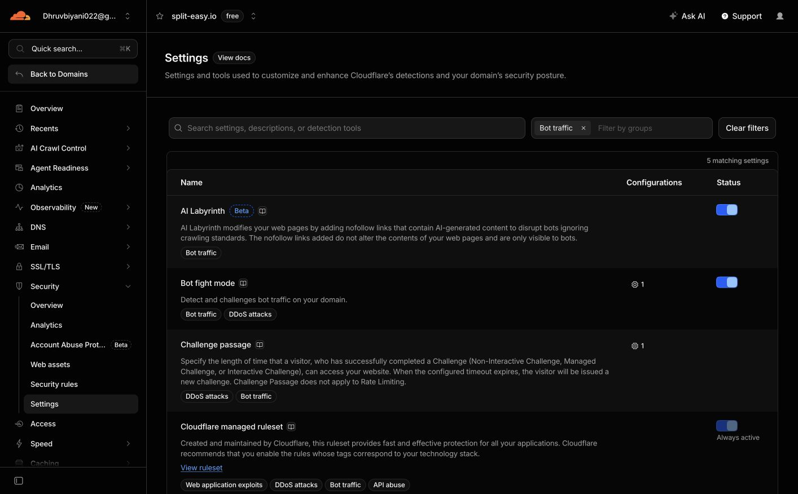
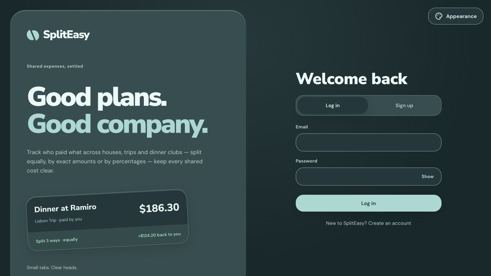
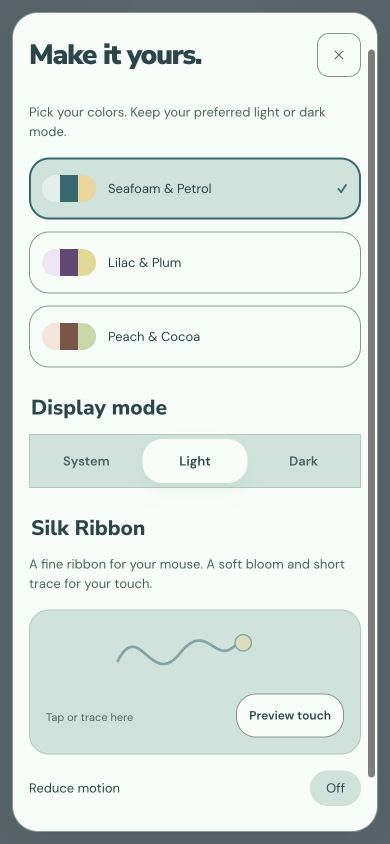
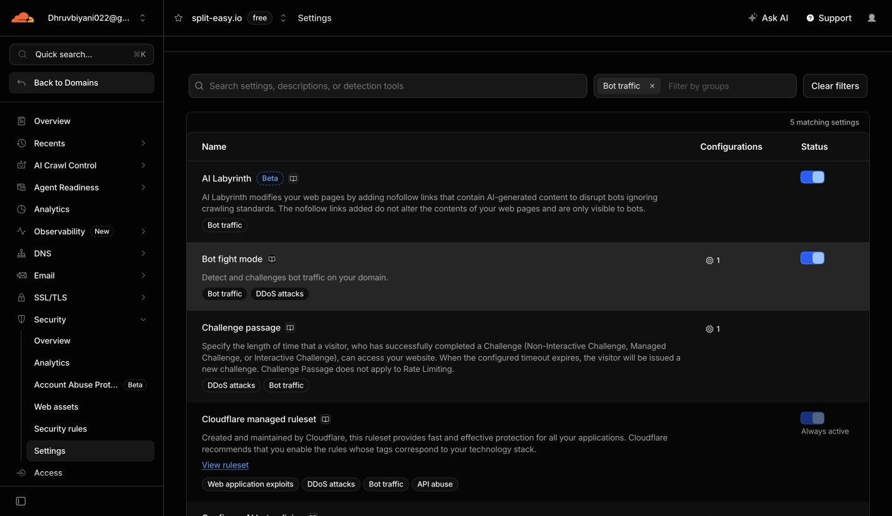

# Pocket Objects production release

Status: **Pocket Objects is live at https://split-easy.io. Production attempt 3 succeeded; Bot Fight Mode is restored to ON.**

## Merge and checks

- [Release PR #71](https://github.com/dHRvBiyAn1/SplitEasy/pull/71), `dev` → `main`, merged on 2026-10-17 at 07:10:28 UTC.
- Main merge: `2a3a1af8af81148bb0fd83ad029f089fac07b9b4`.
- [PR CI](https://github.com/dHRvBiyAn1/SplitEasy/actions/runs/39012329209) passed backend/frontend verification and disposable container origin/persistence smoke checks.
- Codex review completed with no findings. The final history synchronization commit changed only project memory; application, backend and deployment trees remained identical to the reviewed `19b3abb` tree.
- The earlier scoped-expense finding on implementation PR #70 was fixed, covered by four regression cases plus the empty-group case, and its review thread was resolved before merge to dev.
- Latest frontend suite: 110 tests. Latest backend suite: 138 tests. Deployment regressions: 12. Formatting and production build passed.

## Delivery attempts

[Production workflow](https://github.com/dHRvBiyAn1/SplitEasy/actions/runs/39012646574), main `2a3a1af`, attempts 1 and 2:

- Test/build/container checks passed and the backend digest was published.
- Existing deployment scripts verified a pre-release database dump and healthy PostgreSQL/backend/Caddy/cloudflared containers.
- The public API check executed from Lightsail received HTTP 403 before the release pointer/Pages publication steps.
- A read-only request over the existing verified SSH connection identified `cf-mitigated: challenge`, Cloudflare's HTML managed challenge, and an SYD edge response.
- Cloudflare Security → Analytics → Events labels the corresponding Australian server requests **Bot fight mode / Managed Challenge** at 12:45 and 13:07 Asia/Calcutta.
- Public API requests from the developer machine returned HTTP 200 and `status: UP`. The live `/login` browser continued to show the previous Evenly UI. Pocket Objects is therefore not yet verified live.
- An initial retry was not executed because automatic approval review hit its usage limit. After that limit cleared, the normal approval path allowed attempt 2; no approval control was bypassed.

## Approved temporary recovery

The domain uses Free-plan Bot Fight Mode. [Cloudflare's documentation](https://developers.cloudflare.com/bots/get-started/bot-fight-mode/) says this mode protects the whole domain and cannot exempt a health endpoint using WAF custom rules or Page Rules.

User selected **Temporarily turn it off, deploy, then restore it**. Bot Fight Mode was temporarily disabled on 2026-10-17 around 07:42 UTC, with the switch confirmed false. The same public health request from Lightsail immediately returned HTTP 200 and `UP`; delivery attempt 3 succeeded. WAF/DDoS protections, TLS, the private origin and application JWT authentication remained in place. After live checks, the Bot Fight Mode switch was restored and confirmed true around 07:45 UTC. Future unattended delivery may encounter the same false positive after restoration; a permanent exception or plan change was not authorized.

## Live verification

- Production workflow attempt 3 completed successfully for main `2a3a1af8af81148bb0fd83ad029f089fac07b9b4`, including the actual Lightsail/Pages delivery job.
- Exact main-workflow Pages artifact downloaded locally; live main bundle `main-IFBH5XRF.js` and stylesheet `styles-QMEU3J2H.css` match it.
- All **25 JS/CSS/WOFF2 assets** served by the public domain match the artifact's SHA-256 values, including every lazy screen chunk. Results: [live-assets.json](live-assets.json).
- `/login`, `/register`, and `/groups/00000000-0000-0000-0000-000000000000` returned HTTP 200 with `<app-root>` and the expected new main bundle.
- Live browser shows the new “Good plans. Good company.” heading, rounded Pocket Objects layout, DM Sans UI, Seafoam default, named Appearance and Show password controls, and the corrected three-way sample split ($124.20).
- Changed to Lilac + Dark, reloaded, and confirmed the palette, mode and native `color-scheme: dark` persisted independently. Seafoam + Light also worked. Left the verification tab on default Seafoam + System afterward.
- Desktop at 1280px and mobile at 390×844 had no horizontal overflow. Mobile Appearance and registration labels/fields rendered; viewport override was reset after testing.
- One ribbon canvas was mounted. Real-device touch/performance and authenticated production account/expense flows were not exercised; previous local synthetic evidence remains in the implementation report. No production account, group, expense or payment was created or changed.
- After restoring Bot Fight Mode, the live login still rendered Pocket Objects and the public API returned HTTP 200 / `UP` at 07:45:09 UTC.

