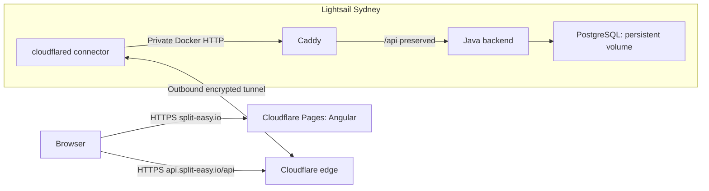

# SplitEasy: Cloudflare Pages, Lightsail and Cloudflare Tunnel

Status: approved by the user on 2026-10-15; plan and native implementation were approved; local implementation is verified and public activation is pending.

## Intent and constraints

The user selected AWS Lightsail for server hosting, Cloudflare Pages for Angular, Cloudflare Tunnel for access to the API, and Caddy as the reverse proxy. The purchased domain is `split-easy.io`. Traffic is negligible and this is a personal project. Reuse the current tested Docker, PostgreSQL backup and GitHub Actions release flow wherever possible. Development stays on `dev`; production deployment follows promotion to `main`. Do not purchase resources, configure external accounts, commit, or push as part of design work.

Public names: `split-easy.io` for the frontend and `api.split-easy.io` for the backend. The user selected the root domain directly; no app subdomain or redirect is required.

## Architecture

The Lightsail production Compose stack contains PostgreSQL, Java, Caddy and cloudflared. No service publishes a public application port. Caddy is an API-only HTTP proxy on its private Docker network; it preserves `/api`, rejects management paths and unknown paths, and adds appropriate response headers including no-store for API responses. It does not serve Angular or request public TLS certificates. Browser HTTPS is provided by Cloudflare; the tunnel encrypts the Cloudflare-to-connector connection. HTTP between connector, Caddy and Java remains inside the host's Docker networks.

cloudflared shares a network with Caddy and can reach the Internet, while PostgreSQL is on an internal network shared only with Java. The remotely managed tunnel publishes `api.split-easy.io` with origin `http://caddy:80`. The origin must not be `localhost` inside the cloudflared container. Cloudflare Tunnel DNS targets the tunnel, rather than an A record targeting the Lightsail IP.

Retain the Lightsail static IPv4 address and verified SSH deployment for now. Port 22 remains a separate administration/deployment path; port 80, 443, 5432, 8080 and internal health ports stay closed publicly. The runbook must explain GitHub-hosted runners' changing source IPs. Tunnel operation requires outbound connectivity, including TCP/UDP 7844; image pulls also need DNS and outbound HTTPS. Moving SSH behind Cloudflare Access is a separate change.

## Frontend and authentication

Cloudflare Pages hosts the Node 22 production Angular build at `split-easy.io`. Use a Direct Upload project named `spliteasy`, with production branch `main`, controlled by GitHub Actions. No independent automatic Git build may publish before repository tests finish. Register the custom hostname through Pages before DNS association.

Local Angular development continues using relative `/api` and the existing proxy. The Pages build uses `https://api.split-easy.io/api` through Angular build configuration, without a new runtime configuration framework. SPA deep links must work on Pages.

Update the shared API base and authentication interceptor together. Tokens are attached only to the configured API base with a correct path boundary. Login/register remain excluded, and unrelated requests never receive the JWT or trigger a global logout for their 401 responses. Add tests covering production absolute URLs, local relative URLs and misleading prefix/foreign-origin requests.

Backend CORS allows exactly `https://split-easy.io` in production, including preflight and the Authorization header. Untrusted origins remain rejected. Previews do not automatically gain production API access. JWT and database secrets remain server-side; frontend bundles contain only public configuration.

## Secrets and infrastructure configuration

Retain GitHub's production environment, `LIGHTSAIL_HOST`, `LIGHTSAIL_USER`, `LIGHTSAIL_SSH_KEY` and verified `LIGHTSAIL_KNOWN_HOSTS`. Add `CLOUDFLARE_API_TOKEN` as a production secret scoped to Pages Edit for the correct account; account ID and Pages project name are environment variables. Do not reuse the tunnel token as a Pages deployment credential.

Keep the tunnel token in a server-only file mounted read-only into cloudflared, using `--token-file` and a compatible pinned image. The file must be readable by the chosen container UID without public/group-wide disclosure. Keep it outside releases and Git, along with PostgreSQL/JWT secrets. Caddy and cloudflared image versions/digests are pinned and updated deliberately.

Keep `DEPLOY_ENABLED` as the last activation switch after the server, tunnel, Pages project, DNS and secrets are ready. New configuration must fail clearly when required secrets or settings are missing, without printing their values. The old combined-stack deployment instructions must be replaced or explicitly marked superseded to prevent accidental direct-port deployment.

## CI/CD and failure handling

1. PRs and `dev` pushes run backend tests/formatting, frontend tests/formatting, production build, and container/API smoke tests. CI uses a loopback-only Caddy port override, without a real tunnel or production credentials.
2. Upload the verified Pages build as a workflow artifact. Publish the tested Java image to GHCR by digest only from `main`; stop publishing the obsolete Angular runtime image.
3. One serialized production deployment skips superseded main revisions, transfers the backend release and Caddy configuration over verified SSH, verifies configuration, pulls images, starts PostgreSQL and takes a validated pre-migration dump before Java starts.
4. Start Java/Caddy/cloudflared and verify internal database readiness plus the public API through the real tunnel. Only then promote the backend release pointer and upload the already verified frontend artifact to Pages with `--branch=main`.
5. Check frontend HTML/deep links after upload. Never create real users or groups during public production smoke checks. Public register/login/group flows are verified only against disposable local/CI stacks.

Backend and Pages publication are not atomic. A backend failure stops Pages deployment. If Pages upload fails, the healthy backend stays deployed and the workflow reports failure; rerun/recovery instructions are provided. API compatibility is required across the short rollout interval. Preserve the host lock, physical release paths, digest validation, volume persistence and previous-release pointer protections. Rollback never restores PostgreSQL automatically; backend rollback is schema-aware and Pages rollback is a separate documented operation.

## Verification and completion criteria

- Node 22 frontend tests, formatting and production build pass; Java 21 full tests and formatting pass.
- Interceptor tests verify no JWT leakage and correct auth/401 behavior for both API address modes.
- Compose default configuration has no published application/database ports, and real Caddy validation passes.
- Disposable Docker smoke covers auth, CORS preflight/denied origin, private management endpoints, Caddy routing, persistence after recreation and a real database backup restore.
- Release tests preserve backup-before-migration order and fail without pointer promotion on configuration/pull/backup/startup/public-API errors.
- Workflow lint passes; Pages production upload is gated by all checks, main-only deployment, environment secrets and deployment activation.
- Runbook covers Lightsail, Docker, token-file permissions, tunnel creation, Pages custom domain, DNS/cache settings, secrets, activation, logs, backups and separate rollback procedures.
- Live deployment is reported only after actual server, tunnel, Pages and browser verification; local implementation alone does not constitute public deployment.

## Official references

- [Cloudflare dashboard-managed tunnels](https://developers.cloudflare.com/cloudflare-one/networks/connectors/cloudflare-tunnel/get-started/create-remote-tunnel/)
- [Tunnel token-file support](https://developers.cloudflare.com/cloudflare-one/networks/connectors/cloudflare-tunnel/configure-tunnels/run-parameters/)
- [Tunnel firewall requirements](https://developers.cloudflare.com/cloudflare-one/networks/connectors/cloudflare-tunnel/configure-tunnels/tunnel-with-firewall/)
- [Pages upload through CI](https://developers.cloudflare.com/pages/how-to/use-direct-upload-with-continuous-integration/)
- [Pages custom domains](https://developers.cloudflare.com/pages/configuration/custom-domains/)
- [Caddy reverse proxy](https://caddyserver.com/docs/caddyfile/directives/reverse_proxy)

Region amendment (2026-10-15): user explicitly selected the existing Sydney instance (`ap-southeast-2`) after the readiness audit. This supersedes the original Mumbai preference; the deployment topology and CI/CD interfaces are unchanged. Commit/push on dev and a PR to main are now authorized; no merge or live deployment is authorized by that publication request.
